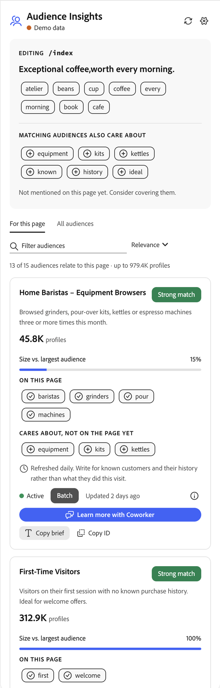

# RTCDP Audience Insights – Experience Workspace side panel

A standalone side-panel extension for Adobe Experience Manager - Experience Workspace (da.live). While you edit a page, it shows which Adobe Real-Time CDP audiences the page speaks to and what those audiences care about. 

## What authors see



- **Page topics**: key terms from the page's title, headings, metadata and body. They update live as you type.
- **Matching audiences also care about**: topics that the page's best-matching audiences care about but the page doesn't mention yet.
- **Audience cards**, ranked by how well they match the page. Each card shows:
  - the match strength, description and profile count
  - **Cares about**: the audience's distinctive topics, with ✓ on the ones already on the page and dashed outlines on the ones missing
  - a timing tip: Edge (real time), Streaming (minutes) or Batch (daily), and what that means for the copy
  - status and last update, plus an ⓘ icon that shows technical details (ID, merge policy, labels, rule) in a popover on hover or keyboard focus
  - **Learn more with Coworker**: opens the Coworker chat (SDK `actions.setPrompt`) with the prompt filled in: *Tell me more about the CDP Audience '&lt;singular audience name&gt;' including the persona rules from Experience Context.* Outside Experience Workspace the prompt is copied to the clipboard instead.
  - **Copy brief** (copies a plain-text audience brief) and **Copy ID**
- The **For this page** and **All audiences** tabs, a filter, and sorting by relevance, size, recency or name.

Opened outside Experience Workspace, the panel runs on a demo page and 15 demo audiences.

## Project layout

```
tools/rtcdp-audiences/        the panel (static files, no build step)
  rtcdp-audiences.html        entry point registered in Experience Workspace
  rtcdp-audiences.js          UI + EW SDK wiring
  rtcdp-audiences.css
  spectrum.js                 loads Spectrum Web Components, workflow icons + Spectrum 2 theme
  rtcdp-api.js                config + proxy client
  relevance.js                page ⇄ audience matching, topics and gaps
  coworker.js                 Coworker prompt + audience name singularisation
  demo-data.js
app-builder/                  App Builder project with the `audiences` proxy action
test/                         node:test unit tests (`npm test`)
```

## 1. Deploy the App Builder proxy

The proxy keeps the Experience Platform credentials server-side. It validates the editor's Experience Workspace IMS token, then calls the AEP Segmentation Audiences API with an OAuth server-to-server credential.

1. In Adobe Developer Console, create an App Builder project. Add the **Experience Platform API** with **OAuth Server-to-Server** credentials. Give the credential a product profile that can read audiences in the sandboxes you need.
2. Configure and deploy:
   ```sh
   cd app-builder
   cp .env.example .env      # fill in AEP_CLIENT_ID, AEP_CLIENT_SECRET, AEP_ORG_ID, ALLOWED_SANDBOXES
   aio login
   aio app use               # pick the project/workspace from step 1
   aio app deploy
   ```
3. Note the action URL, e.g. `https://<namespace>.adobeioruntime.net/api/v1/web/rtcdp-audiences/audiences`.

| `.env` key | Purpose |
|---|---|
| `AEP_CLIENT_ID`, `AEP_CLIENT_SECRET`, `AEP_ORG_ID` | OAuth server-to-server credential for Experience Platform |
| `AEP_SCOPES` | optional; scopes from the credential page |
| `ALLOWED_SANDBOXES` | comma-separated sandboxes the panel may read (default `prod`) |
| `ALLOWED_ORIGINS` | optional; origins allowed to call the proxy, e.g. where the panel is hosted |
| `ALLOWED_CLIENT_IDS` | optional; only accept caller tokens issued to these IMS client IDs |

Proxy contract: `GET {proxyUrl}?sandbox=prod&limit=100&start=0` with `Authorization: Bearer <IMS token>`. It returns `{ children: [...audiences], _page: { totalCount, next } }` in the AEP Audiences API shape, trimmed to the fields the panel uses. Only standard headers are sent, so the web action's default CORS handling works.

## 2. Host the panel

The panel is plain static files with no build step, so it can live on any HTTPS host. Options include its own Edge Delivery Services repo (`https://main--<repo>--<owner>.aem.live/tools/rtcdp-audiences/rtcdp-audiences.html`), App Builder static hosting, or a CDN.

For local development, run `npm start`, which serves `http://localhost:3000`.

## 3. Register it in Experience Workspace

For each site that should show the panel:

1. Open `https://da.live/config#/{org}/{site}`. On the **library** sheet, add a row with title `Audiences` and the panel URL as `path`.
2. Add an **`rtcdp`** sheet with `key`/`value` columns:

   | key | value |
   |---|---|
   | `proxyUrl` | the action URL from step 1 |
   | `sandbox` | e.g. `prod` |

With a `proxyUrl` configured, the panel loads live audiences. Without one, it shows demo data. Authors can override these values for themselves from the ⚙ settings; the override is stored in their browser.

## Development

- `npm test` runs the matching tests and the proxy tests (with a stubbed `fetch`).
- The jsDelivr `+esm` builds of SWC ship a private copy of the `Theme` class in each module. Spectrum 2 fragments registered through `theme-*.js` imports therefore never reach `<sp-theme>`. `spectrum.js` works around this by registering the CSS fragments directly on `customElements.get('sp-theme')`. The SWC version is pinned to 1.12.6.
- Every control is a Spectrum Web Component (`sp-tags`, `sp-meter`, `sp-accordion`, `sp-alert-banner`, `sp-illustrated-message`, `sp-action-group`, `sp-icon-*` workflow icons). The CSS covers layout only and uses Spectrum 2 tokens for colour, type, spacing and radius. Adobe Clean comes from an Adobe Fonts (Typekit) kit. Kits are domain-restricted, so on other hosts the panel falls back to the Spectrum font stack.
